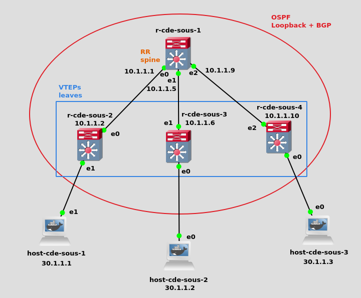
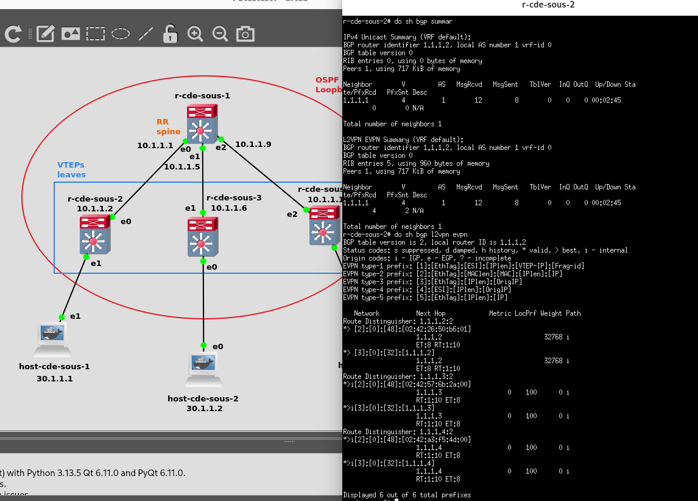
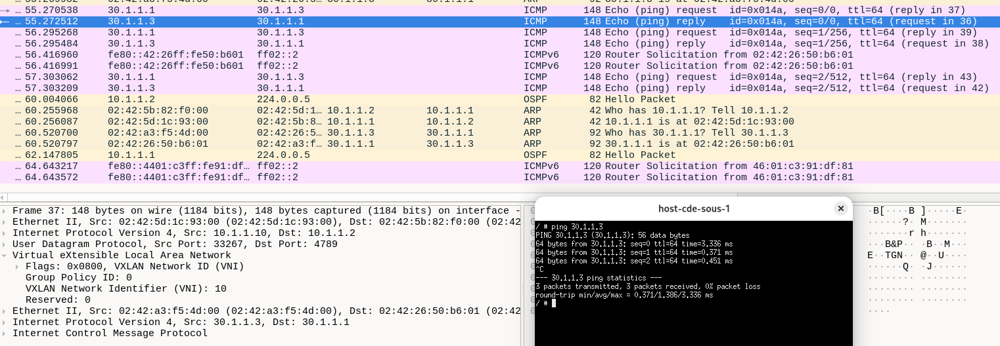

# BADASS - Network virtualization with VXLAN and BGP EVPN
Implementation of a virtualized network infrastructure using GNS3, Docker, VXLAN, and BGP EVPN.

## Overview
BADASS (BGP At Doors of Autonomous Systems is Simple) is a networking project that focuses on the use of BGP and OSPF.

This project serves as an understanding of how isolated Layer 2 networks can communicate over a Layer 3 infrastructure, progressing from a VXLAN tunneling (P2) to a BGP EVPN (P3) configuration.

## Demo
The topology illsustrating a virtual network infrastructure

The BGP EVPN routing status

The connectivity check between network endpoints validated by ICMP

## Main tasks
### P1
- Build Docker images for network hosts and routers
- Configure FRRouting daemons
### P2
- Configure bridged VXLAN tunnels between virtual network endpoints (unicast and multicast)
- Inspect encapsulated traffic and validate connectivity with Wireshark
### P3
- Configure bridged VXLAN tunnels
- Configure BGP peering between network devices with EVPN and OSPF

## Troubleshooting
- `ip addr` and `ip route` `ip -d link` to inspect interfaces and routing tables
- `ping` to test end-to-end reachability
- FRRouting commands to inspect BGP neighbors and routing information

## Running BADASS
1. Install and configure the required tools
2. Build the Docker images using the provided build files
3. Import the GNS3 project in GNS3
4. Run connectivity and routing checks
